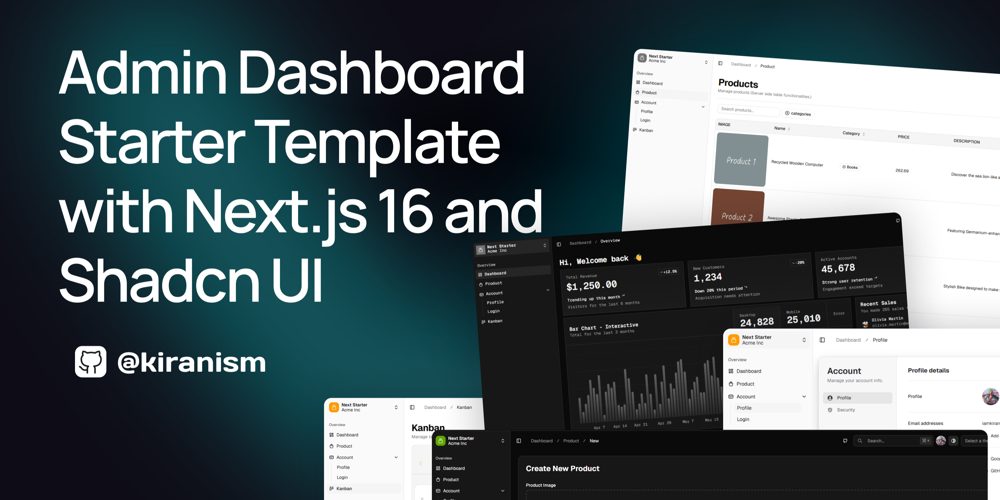

<h1 align="center">Survai</h1>

<div align="center">
  <strong>Design smarter surveys. Generate better insights. Make better decisions.</strong>
</div>

<div align="center">
  An AI-powered platform that helps organizations design better surveys, collect quality data, analyze results, and generate actionable reports.
</div>

<br />

<div align="center">
  
</div>

<br />

<p align="center">
  
  
  
  
  <a href="LICENSE"></a>
</p>

<p align="center">
  <a href="#1-executive-summary">Product</a> ·
  <a href="#11-technical-architecture">Architecture</a> ·
  <a href="#getting-started">Getting started</a> ·
  <a href="#20-glossary">Glossary</a>
</p>

---

## Document status

| Field | Value |
| --- | --- |
| **Product** | Survai |
| **Partners** | Code for Africa (CfA), Dire Integrated Community Development Organization (DICDO) |
| **Product Lead / Fellow** | Yosef Lakew |
| **CSO Partner Lead** | Mr. Demissie Afework (Executive Director & General Manager, DICDO) |
| **PRD status** | Under review |
| **Repo** | Full-stack monorepo (`frontend/` + `backend/`) |

This README is the **canonical product + engineering brief**: product requirements, trust model, and how to run the codebase.

---

## Table of contents

1. [Executive summary](#1-executive-summary)
2. [Product context & validation](#2-product-context--validation)
3. [Problem definition](#3-problem-definition)
4. [Vision & principles](#4-product-vision-and-principles)
5. [Target users & personas](#5-target-users--personas)
6. [End-to-end user journey](#6-end-to-end-user-journey)
7. [Product scope & modules](#7-product-scope--modules)
8. [Functional requirements](#8-detailed-functional-requirements)
9. [AI requirements & guardrails](#9-ai-requirements--guardrails)
10. [Data, analytics & statistics](#10-data-analytics--statistical-requirements)
11. [Technical architecture](#11-technical-architecture)
12. [Data model](#12-data-model)
13. [Non-functional requirements](#13-non-functional-requirements)
14. [Security, privacy & responsible AI](#14-security-privacy--responsible-ai)
15. [MVP delivery plan](#15-mvp-delivery-plan)
16. [Success metrics](#16-success-metrics)
17. [Risks & mitigations](#17-risks--mitigations)
18. [Testing & acceptance](#18-testing--acceptance)
19. [Open questions & assumptions](#19-open-questions--assumptions)
20. [Glossary](#20-glossary)
- [Getting started](#getting-started)
- [Repository structure](#repository-structure)
- [Canonical product language](#appendix-b--canonical-product-language)

---

## 1. Executive summary

Dire Integrated Community Development Organization (DICDO) conducts field research, peacebuilding evaluations, women and youth empowerment surveys, and community assessments across Dire Dawa and regional Ethiopia. Across that lifecycle they face the same bottlenecks many CSOs and research teams face: manual questionnaire drafting, slow field collection, spreadsheet analysis, and labor-intensive donor report writing.

**Survai** is an AI-powered platform that helps organizations design better surveys, collect quality data, analyze results, and generate actionable reports. DICDO is the initial validation and pilot context; the product is designed to scale beyond one CSO.

**North star:** Enable DICDO to deploy **10+ surveys** and generate **20+ survey reports** with **0% statistical numerical hallucinations** across its active programs.

**Core product principle**

> Use AI where judgment, language, synthesis, and drafting are valuable. Use deterministic software where exact calculations, data integrity, filtering, and reproducibility matter.

### 1.1 Product at a glance

| Stage | Capability | Primary outcome |
| --- | --- | --- |
| **Plan** | AI Survey Planner | Clearer research objective, audience, structure, and draft plan |
| **Build** | AI + Manual Survey Builder | Usable survey created quickly without removing human control |
| **Review** | AI Survey Reviewer | Higher-quality questions and fewer avoidable design issues |
| **Collect** | Survey Collection | Structured responses via a simple web experience |
| **Analyze** | Survey Statistics & Analysis | Transparent, reproducible statistics and visualizations |
| **Report** | AI Report Generator + Chat | Professional narrative reporting and conversational exploration of findings |

**In one sentence:** Survai helps an organization move from “We need to learn something” to “Here are reliable findings and a report we can act on.”

---

## 2. Product context & validation

DICDO is a local Ethiopian development organization whose work spans peacebuilding and conflict resolution, education and literacy, women and youth empowerment, health and nutrition, WASH, environmental protection, and inclusion and human rights — plus community training, election observation, and impact reporting.

That breadth matters for product design: Survai must support **different survey purposes** (training evaluation, community needs, beneficiary feedback, program baseline) rather than being hard-coded for one topic.

DICDO is the **initial validation partner**, not the permanent boundary of the product.

---

## 3. Problem definition

### 3.1 Core problem

Organizations can collect survey data, but the workflow from research objective to reliable report remains fragmented and labor-intensive: plan in documents, build in a form tool, collect responses, move data into spreadsheets, then manually write the final report.

### 3.2 Problem breakdown

| Friction | What happens |
| --- | --- |
| **Planning** | Questions get written before objective, audience, and decision needs are clear |
| **Question quality** | Leading, ambiguous, or double-barreled wording reduces data quality |
| **Workflow fragmentation** | Creation, collection, analysis, and reporting live in separate tools |
| **Analysis effort** | Cleaning, filtering, aggregating, and cross-tabs eat hours |
| **Reporting effort** | Turning stats into a clear report is manual and repetitive |
| **Decision gap** | Hundreds of responses still don’t answer: “What should we do next?” |

### 3.3 Out of scope for MVP

- Full-scale offline mobile data collection (Kobo/ODK-class)
- Complex sample management or panel recruitment
- Advanced causal inference / experimental-design automation
- Autonomous decision-making without human review
- Replacing specialist statisticians for advanced studies

---

## 4. Product vision and principles

| Principle | Meaning |
| --- | --- |
| **Human-controlled** | AI suggests, drafts, and explains. Humans edit, reject, or accept before publish or report. |
| **Numerical integrity** | Core stats are calculated deterministically. LLMs are never the source of truth for counts, %, means, or cross-tabs. |
| **Evidence-grounded reporting** | Every narrative claim should trace to computed metrics or selected qualitative responses. |
| **Explainable AI** | Flags and insights come with a why. |
| **Simple by default** | Basic survey workflows should not require research-methodology expertise. |
| **Responsible data handling** | Privacy and access controls are first-class; responses may be sensitive. |

---

## 5. Target users & personas

Working personas for design (to be validated in discovery — not claims about specific DICDO staff):

| Persona | Goals | Pain points | Primary features |
| --- | --- | --- | --- |
| **Program / M&E Officer** | Reliable data, quick analysis, donor-ready outputs | Manual design, spreadsheets, report writing | Planner, Builder, Analytics, Reports |
| **Field / Enumerator** | Fast, clear collection on phone/laptop | Long forms, unclear questions, connectivity | Collection |
| **Research / Policy User** | Methodological quality and useful comparisons | Design bias, interpretation effort | Planner, Reviewer, Analytics |
| **Program Manager / Executive** | Quick understanding and decisions | Long reports, scattered findings | Report Generator, Report Chat |

Broader landing audience: CSOs, NGOs, researchers, and policy teams — shaped with Ethiopian civil society, designed to scale.

---

## 6. End-to-end user journey

1. **Define** — User explains what they want to learn and what decision the survey should support.
2. **Plan** — AI Survey Planner proposes objectives, research questions, target respondents, and sections.
3. **Build** — User accepts AI-generated questions, edits them, or builds manually.
4. **Review** — AI Survey Reviewer checks wording, bias risks, structure, and estimated burden.
5. **Publish** — User publishes a survey link and configures response settings.
6. **Collect** — Respondents submit answers through a responsive web interface (`/s/...`).
7. **Analyze** — System calculates statistics, visualizations, filters, and cross-tabs deterministically.
8. **Report** — AI turns validated statistics and selected qualitative evidence into a structured report.
9. **Ask** — User chats with the report to explore findings and prepare concise versions for different audiences.

---

## 7. Product scope & modules

### 7.1 MVP modules

| Module | Purpose | AI role | Priority |
| --- | --- | --- | --- |
| AI Survey Planner | Turn a research goal into a structured plan | Generate/refine objectives, questions, sections, audience | Must |
| Survey Builder | Create the survey | AI generation + full manual editing | Must |
| AI Survey Reviewer | Improve quality before publish | Flag issues + proposed rewrites with explanations | Must |
| Survey Collection | Collect responses | Not required for core collection | Must |
| Survey Statistics & Analysis | Reliable quantitative analysis | Not used for core calculations | Must |
| AI Report Generator + Report Chat | Narrative reports + follow-up Q&A | LLM grounded in computed results + selected responses | Must |

### 7.2 Explicitly out of scope (MVP)

- Survey-to-survey comparison across time
- External survey imports (CSV/XLSX/Kobo-style)
- Multilingual generation and translation
- Offline-first mobile collection
- Advanced sampling and weighting
- Reusable org template libraries
- Integrations with external data-collection systems

---

## 8. Detailed functional requirements

### 8.1 AI Survey Planner

| ID | Requirement | Priority | Acceptance |
| --- | --- | --- | --- |
| PLN-01 | Enter survey purpose in natural language | Must | Free-text goal → structured draft plan |
| PLN-02 | AI proposes objectives and research questions | Must | Editable before generating survey content |
| PLN-03 | AI proposes target groups and sections | Must | Recommendations, not locked fields |
| PLN-04 | AI estimates survey length | Should | Labeled estimate from question count/type |
| PLN-05 | Users can edit the plan | Must | Changes persist and pass to builder |

### 8.2 Survey Builder — AI mode

| ID | Requirement | Priority | Acceptance |
| --- | --- | --- | --- |
| BLD-01 | Generate first-draft from approved plan | Must | Sections, questions, types, required/optional |
| BLD-02 | Regenerate a section without full rebuild | Should | Only selected content changes |
| BLD-03 | Edit all AI-generated content | Must | Nothing immutable |
| BLD-04 | Suggest conditional logic | Should | Preview + human confirm before publish |

### 8.3 Survey Builder — Manual mode

| ID | Requirement | Priority | Acceptance |
| --- | --- | --- | --- |
| BLD-05 | Create, edit, delete, duplicate, reorder | Must | Reflected in preview |
| BLD-06 | Core question types | Must | Short/long text, single/multi choice, dropdown, rating/scale, number, date |
| BLD-07 | Required / optional | Must | Collection blocks missing required answers |
| BLD-08 | Basic branching | Should | Testable in preview |

### 8.4 AI Survey Reviewer

| ID | Requirement | Priority | Acceptance |
| --- | --- | --- | --- |
| REV-01 | Leading / loaded wording | Must | Question, issue type, explanation, alternative |
| REV-02 | Double-barreled questions | Must | Flag when one question asks two things |
| REV-03 | Ambiguity / unnecessary complexity | Must | Understandable to non-technical users |
| REV-04 | Objective ↔ question alignment | Should | Weak/missing coverage called out |
| REV-05 | Survey burden estimate | Should | Est. time + required question count |
| REV-06 | Overall quality summary | Should | Advisory score with criteria (not scientific certification) |

### 8.5 Survey Collection

| ID | Requirement | Priority | Acceptance |
| --- | --- | --- | --- |
| COL-01 | Publish shareable web link | Must | Works on modern mobile + desktop |
| COL-02 | Capture responses reliably | Must | Stored with survey/version IDs |
| COL-03 | Anonymous collection | Must | No identifying fields required |
| COL-04 | Completion progress | Should | Clear position in multi-page surveys |
| COL-05 | Validate inputs | Must | Invalid formats rejected before submit |

### 8.6 Survey Statistics & Analysis

| ID | Requirement | Priority | Acceptance |
| --- | --- | --- | --- |
| ANL-01 | Response counts and distributions | Must | Counts reconcile with stored responses |
| ANL-02 | Percentages | Must | Deterministic code; explicit denominators |
| ANL-03 | Filtering / subgroup analysis | Must | Recalculate from selected subset |
| ANL-04 | Basic cross-tabs | Must | Two categoricals → counts + % |
| ANL-05 | Visualize results | Must | Charts match table values |
| ANL-06 | Export analysis | Should | Preserve labels and filters |

### 8.7 AI Report Generator + Report Chat

| ID | Requirement | Priority | Acceptance |
| --- | --- | --- | --- |
| RPT-01 | Generate from validated results | Must | No invented unsupported values |
| RPT-02 | Standard sections | Must | Exec summary, methodology, respondent profile, key findings, recommendations, conclusion |
| RPT-03 | Audience / tone | Should | Internal, donor/professional, executive-summary |
| RPT-04 | Chat with report | Must | Grounded in report + source analytics |
| RPT-05 | Edit before export | Must | Modify text; regenerate sections |
| RPT-06 | Export | Must | At least DOCX/PDF (or supported pipeline) |

---

## 9. AI requirements & guardrails

Survai uses AI for language-heavy and judgment-supporting tasks. It must **not** delegate deterministic computation to an LLM. That distinction is the product’s trust model.

### 9.1 AI components

| Capability | Model behavior | Grounding / control |
| --- | --- | --- |
| Survey planning | Generate/refine objectives, questions, structure | User approval; prompt templates; structured schemas |
| Question generation | Draft questions and response types | Editable; schema validation; reviewer pass |
| Question review | Identify quality issues | Issue type + rationale + rewrite; human decision |
| Report generation | Narrative synthesis of validated findings | Only pass computed metrics + selected evidence |
| Report chat | Answer questions about the report | Restrict to report + linked analytics; disclose uncertainty |

### 9.2 Anti-hallucination strategy

1. Never ask the LLM to calculate core counts or percentages when the backend can.
2. Pass computed values into report prompts as structured data — do not ask the model to derive them from raw rows.
3. For qualitative summaries, preserve links to source responses where feasible.
4. Use structured output schemas and validate before render.
5. If evidence is insufficient, say so — do not invent a conclusion.
6. Users can regenerate or edit AI sections without modifying underlying survey data.

---

## 10. Data, analytics & statistical requirements

The analytics layer is the **system of record** for survey metrics. AI consumes results; it does not replace the calculation engine.

### 10.1 Core statistical outputs

- Response count, valid count, missing count
- Percent distributions
- Mean / median for supported numeric variables
- Rating-scale summaries
- Cross-tab counts and row/column percentages
- Response completion rate
- Estimated completion time for future surveys

### 10.2 Data quality rules

- Question type determines allowable data type
- Numeric fields validate before analysis
- Missing values are explicit — never silently zeroed
- Filters used for a chart/report are stored with analysis context
- Survey versioning prevents published instruments from changing historical response meaning

---

## 11. Technical architecture

Layers are separated so AI failures cannot corrupt survey data or numerical results.

| Layer | Technology | Responsibility |
| --- | --- | --- |
| Web application | Next.js 16 + TypeScript + Tailwind CSS v4 + shadcn/ui | Planner, builder, reviewer, collection, analytics, reports, landing |
| Application / API | FastAPI (Python 3.12) | Auth, survey CRUD, responses, analytics orchestration, AI orchestration |
| Database | PostgreSQL 16 | Users, surveys, versions, questions, responses, reports, analytics metadata |
| ORM / migrations | SQLAlchemy 2 (async) + Alembic | Persistence and schema evolution |
| Analytics engine | Python + SQL | Deterministic calculations and transforms |
| AI provider | LLM API (e.g. Gemini via `google-genai`) | Planning, generation, review, report narrative, report chat |
| Auth | JWT access + httpOnly cookies; opaque refresh tokens | Organization workspaces; server is source of truth |
| Object storage | S3-compatible / similar | Exports and optional assets |
| Observability | App logs + optional Sentry | Failures without dumping survey content unnecessarily |

### 11.1 High-level data flow

```
User (Next.js)
    │  HTTPS + httpOnly cookies
    ▼
FastAPI (/api/v1)
    ├── Auth / Survey CRUD / Collection
    ├── Analytics engine  ──►  computed metrics (source of truth)
    └── AI orchestration  ──►  LLM (language only; metrics injected)
            │
            ▼
       PostgreSQL
```

**Rule:** Raw responses → deterministic analytics → structured metrics → (optional) LLM narrative. Never the reverse for numbers.

### 11.2 Frontend stack (canonical)

| Concern | Choice |
| --- | --- |
| UI | shadcn/ui on Base UI |
| Server/async state | TanStack Query |
| Forms | React Hook Form + Zod |
| Client UI state | Zustand |
| Charts | Recharts |
| Tables | TanStack Table |
| Auth client | Cookie-based session against FastAPI (no access tokens in `localStorage`) |

### 11.3 Backend stack (canonical)

| Concern | Choice |
| --- | --- |
| API | FastAPI |
| Architecture | routes → services → repositories → models |
| Validation | Pydantic v2 + pydantic-settings |
| Tests | Pytest + httpx + pytest-asyncio |
| Lint | Ruff |

---

## 12. Data model

A relational model is preferred: surveys, questions, versions, responses, and analytics have strong relationships and need consistency.

Core concepts (logical):

- **Organization / user** — workspace membership and roles
- **Survey** — container for the research instrument
- **Survey version** — immutable published snapshot used for collection
- **Section / question** — structure and question types
- **Response / answer** — respondent submissions tied to a version
- **Analysis context** — filters, cross-tabs, saved views
- **Report** — generated narrative grounded in analytics outputs

Versioning must ensure historical responses always map to the instrument respondents actually saw.

---

## 13. Non-functional requirements

| Area | Requirement | MVP target |
| --- | --- | --- |
| Performance | Builder and analytics responsive on normal broadband/mobile | Typical interactions &lt; 2.5s excluding AI |
| AI latency | Long AI actions show progress | No blank waiting screens |
| Reliability | Submitted responses must not be lost to UI failure | Transactional persistence + retry-safe submit |
| Security | HTTPS, secrets, server-side authz, validation, parameterized queries | Mandatory |
| Accessibility | Keyboard, contrast, labels, accessible controls | WCAG 2.1 AA-aligned MVP |
| Responsiveness | Respondent UX on common mobile sizes | Mandatory |
| Observability | Log errors/AI/job failures without unnecessary PII | Mandatory |
| Maintainability | Version AI prompts and output schemas | Mandatory |

---

## 14. Security, privacy & responsible AI

### 14.1 Sensitive data

Survey responses may include personal, demographic, health, legal, or other sensitive information.

- Collect only fields needed for the stated research objective
- Separate identity from answers when anonymous/pseudonymous collection is required
- Clear data-retention policy for the pilot
- Role-based access for authors and admins
- Avoid direct identifiers in AI prompts unless necessary and explicitly permitted
- Log AI actions for debugging without creating an uncontrolled second copy of sensitive responses

### 14.2 Responsible AI

- Present AI as assistance, not authoritative research truth
- Frame reviewer findings as potential issues, not formal methodological certification
- Link recommendations to observed findings where possible
- Users can reject or edit AI output
- Surface uncertainty when evidence is weak or conflicting
- Language/localization must be validated by people familiar with the target community

---

## 15. MVP delivery plan

8-week fellowship horizon — vertical slice early, not a big-bang at the end.

| Week | Focus | Key outputs |
| --- | --- | --- |
| 1 | Discovery + architecture | Validated workflow, MVP scope, UX skeleton, schema, AI contracts |
| 2 | Planner + survey model | AI planner, survey CRUD, versioning foundation |
| 3 | Builder | Manual builder + AI generation, preview, validation |
| 4 | Reviewer + collection | AI reviewer, publish flow, respondent collection |
| 5 | Analytics engine | Deterministic stats, charts, filters, cross-tabs |
| 6 | Report generation | AI report pipeline, templates, grounding, editable report |
| 7 | Report chat + hardening | Chat, export, permissions, error handling, instrumentation |
| 8 | Pilot + polish | DICDO/user testing, fixes, docs, demo-ready MVP |

### 15.1 Definition of MVP complete

- [ ] Create a survey manually or from an AI-generated draft
- [ ] Run the AI reviewer and act on suggestions
- [ ] Publish and collect real responses
- [ ] View deterministic statistics and basic cross-tabs
- [ ] Generate a report whose numerical values match analytics
- [ ] Ask questions about the generated report
- [ ] Core workflow tested with real or representative survey data

---

## 16. Success metrics

| Outcome | Metric | Initial target / approach |
| --- | --- | --- |
| Faster design | Time from research goal → first usable draft | Baseline with DICDO; target &lt; 20 min for a simple draft |
| Better survey quality | Issues caught before publish | Qualitative precision/recall with experienced users |
| Faster analysis | Time from close → first usable analysis | Measure vs current DICDO workflow |
| Faster reporting | Time from analysis → first editable report | Minutes, not hours |
| Numerical integrity | Report metric reconciliation rate | **100%** of displayed numbers match analytics |
| Adoption | Full lifecycle completions | Pilot target set with DICDO after discovery |
| Satisfaction | Post-task usefulness | Target ≥ 4/5 in pilot feedback |

---

## 17. Risks & mitigations

| Risk | Likelihood | Impact | Mitigation |
| --- | --- | --- | --- |
| Misleading survey advice | Medium | High | Human review, explanations, structured outputs, eval set |
| Incorrect report numbers | Low (if architecture followed) | High | Never calc metrics in LLM; pass validated metric objects; reconciliation tests |
| Privacy incident | Medium | High | Minimization, authz, encryption, provider controls, pilot policy |
| Scope creep | High | High | Freeze MVP modules; backlog separately |
| Low adoption | Medium | High | Co-design with DICDO; real workflows; low setup friction |
| Weak methodology advice | Medium | Medium | Position as assistance; human review; tested prompts |
| Poor connectivity | Medium | Medium | Lightweight collection first; offline later if pilot proves need |
| Vendor/API dependency | Medium | Medium | Abstract AI behind a service layer; provider-agnostic prompts/schemas |

---

## 18. Testing & acceptance

### 18.1 Functional

- Survey creation and versioning
- Required-field validation
- Conditional logic behavior
- Response persistence
- Statistics reconciliation
- Report generation from known datasets
- Report chat grounding
- Permissions and authorization

### 18.2 AI evaluation

- Test set of intentionally flawed questions → expected reviewer flags
- Known datasets → report numbers exactly match analytics
- Unsupported causal questions (“What is the true cause?”) when data is only descriptive
- Empty / contradictory / incomplete results → AI states limitations
- Reports judged for grounding, structure, tone, editability

### 18.3 User acceptance

Pilot users complete at least one end-to-end workflow on a realistic program scenario. Capture time saved, perceived quality, trust in AI, and remaining friction.

---

## 19. Open questions & assumptions

- Which survey types does DICDO run most often?
- Current collection methods (paper, Google Forms, Kobo, ODK, spreadsheets, other)?
- Frequency and typical response dataset size?
- Required report formats for DICDO and partners?
- Languages for authoring and respondent collection?
- What data must stay inside the org vs. may go to a third-party model provider?
- Existing M&E quality checks already in use?
- Stats beyond descriptive analysis and cross-tabs needed for the pilot?
- Which metrics are official fellowship success measures?

**Important assumption:** This document distinguishes validated facts about DICDO from product hypotheses. Anything that depends on DICDO’s internal workflow must be confirmed in discovery before becoming a hard technical commitment.

---

## 20. Glossary

| Term | Meaning |
| --- | --- |
| **Survey** | Structured set of questions used to collect information from respondents |
| **Survey Planner** | Helps define why the survey is run and what it should measure |
| **AI Survey Builder** | AI assistance that drafts a questionnaire from a research goal |
| **Survey Reviewer** | AI that flags common quality problems and suggests improvements |
| **Deterministic analytics** | Calculations in normal software logic — same input, same numbers |
| **Cross-tabulation** | Table comparing responses across two variables |
| **LLM** | Large Language Model used for language understanding/generation |
| **Prompt** | Instructions sent to an AI model |
| **Human-in-the-loop** | People review and control AI outputs rather than full autonomy |
| **MVP** | Smallest usable product that validates the core idea |

---

## Appendix A — Product scope snapshot

> Survai helps an organization move from “We need to learn something” to “Here are reliable findings and a report we can act on.”

---

## Appendix B — Canonical product language

| Use | Approved wording |
| --- | --- |
| Product name | **Survai** |
| Tagline | Design smarter surveys. Generate better insights. Make better decisions. |
| Product description | An AI-powered platform that helps organizations design better surveys, collect quality data, analyze results, and generate actionable reports. |
| Primary positioning | End-to-end AI-assisted survey lifecycle platform |
| Pilot context | DICDO is the initial validation partner; the product is designed to scale beyond one CSO |

---

# Getting started

Monorepo layout:

```
survai/
├── frontend/     # Next.js 16 app (UI + landing + dashboard)
├── backend/      # FastAPI API (auth, surveys, AI, analytics)
└── README.md     # This document
```

### Prerequisites

- **Node.js 20+** and [Bun](https://bun.sh) (preferred) or npm
- **Python 3.12** and [uv](https://docs.astral.sh/uv/) (or a venv + pip)
- **Docker** (recommended for Postgres)

### 1. Backend

```bash
cd backend
cp .env.example .env
docker compose up --build
```

- API: http://localhost:8000  
- OpenAPI docs: http://localhost:8000/docs  
- Health: http://localhost:8000/api/v1/health  
- Postgres: `localhost:5432` (user/pass/db: `survai`)

Local API without Docker for the app process:

```bash
cd backend
uv python install 3.12
uv venv --python 3.12 .venv && source .venv/bin/activate
uv pip install -r requirements.txt
cp .env.example .env
docker compose up -d db
alembic upgrade head
uvicorn app.main:app --reload --port 8000
```

See `backend/README.md` for Traefik, Mailpit, and production notes.

### 2. Frontend

```bash
cd frontend
bun install
cp env.example.txt .env.local
# set NEXT_PUBLIC_API_BASE_URL=http://localhost:8000/api/v1
bun run dev
```

App: http://localhost:3000

### Environment variables (summary)

**Frontend (`.env.local`)**

| Variable | Purpose |
| --- | --- |
| `NEXT_PUBLIC_API_BASE_URL` | FastAPI base (default `http://localhost:8000/api/v1`) |
| `BUILD_STANDALONE` | `true` for Docker / standalone Next output |
| Sentry vars | Optional error tracking |

**Backend (`.env`)**

| Variable | Purpose |
| --- | --- |
| `DATABASE_URL` | Async Postgres URL |
| `CORS_ORIGINS` / `FRONTEND_URL` | Frontend origin (e.g. `http://localhost:3000`) |
| `JWT_SECRET_KEY` | Access token signing |
| Cookie / SMTP / Resend / AI provider keys | Per `backend/.env.example` |

---

## Repository structure

```
frontend/src/
├── app/                  # App Router (landing, auth, dashboard, /s collection)
├── components/           # UI primitives, layout, themes
├── features/             # Domain modules (surveys, builder, collect, analytics, reports, board, …)
├── lib/                  # API client, auth helpers, utils
├── hooks/ · config/ · constants/ · styles/ · types/

backend/app/
├── api/v1/routes/        # HTTP handlers
├── services/             # Business use-cases
├── repositories/         # Data access
├── models/               # SQLAlchemy ORM
├── schemas/              # Pydantic contracts
├── ai/                   # AI orchestration
├── core/                 # Config, security, exceptions
└── db/                   # Engine, session, Base
```

Feature API pattern on the frontend:

```
src/features/<name>/api/
  types.ts      # contracts
  service.ts    # data access
  queries.ts    # React Query keys + options
```

---

## License

MIT. See [LICENSE](LICENSE).
