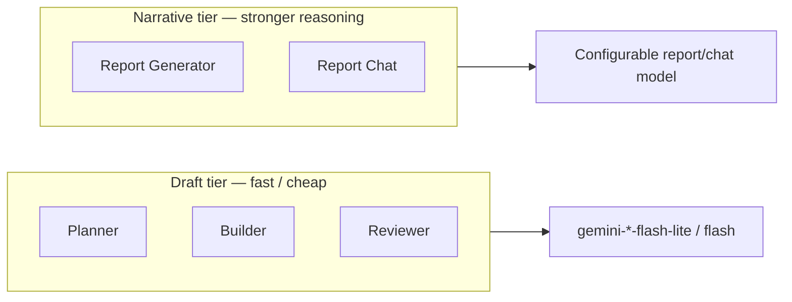
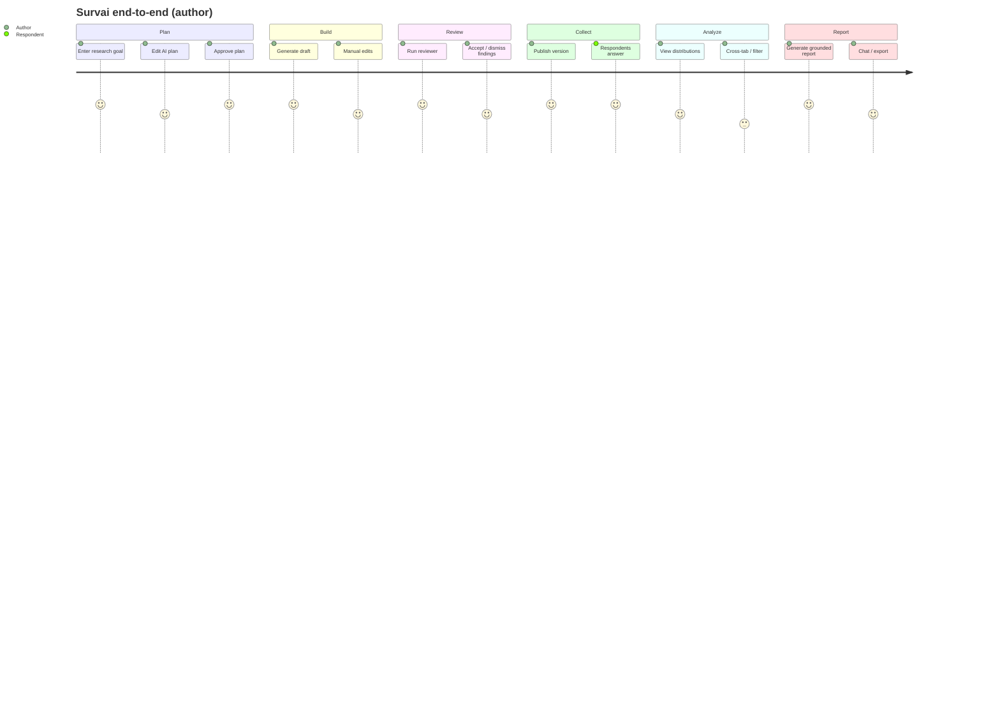
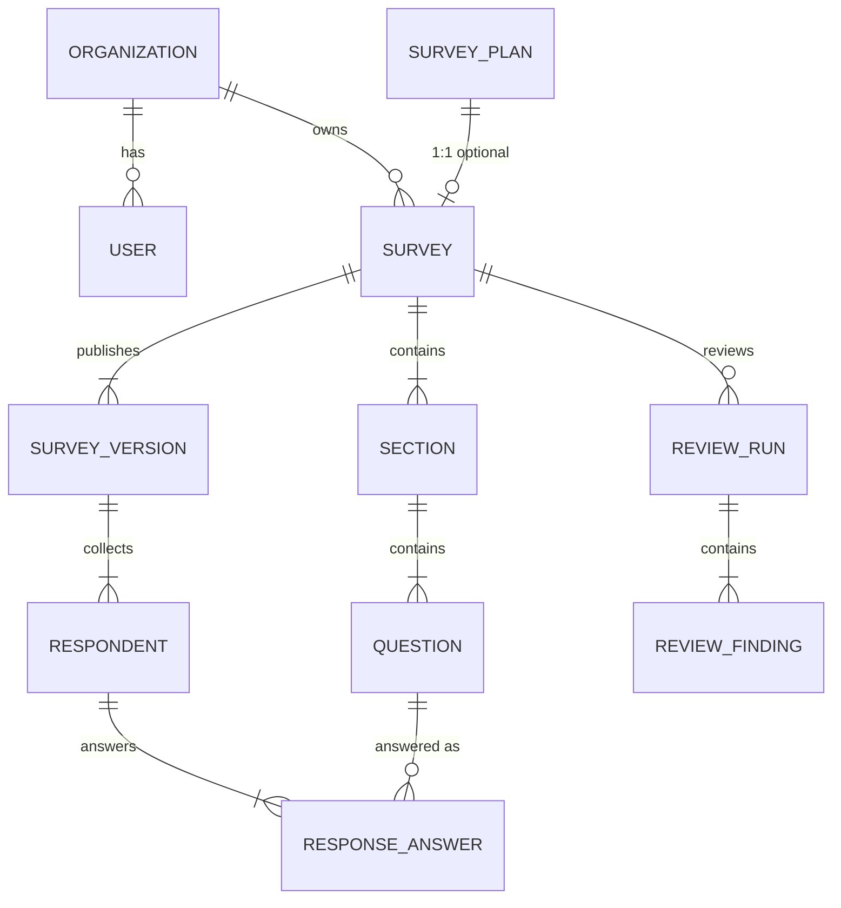
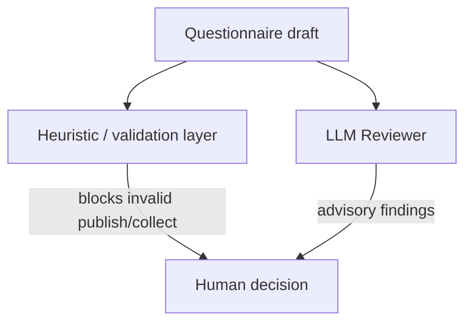
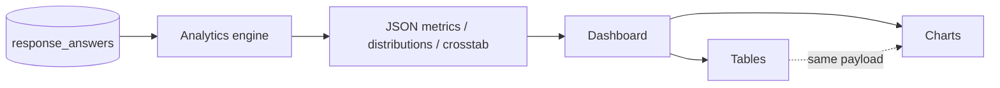
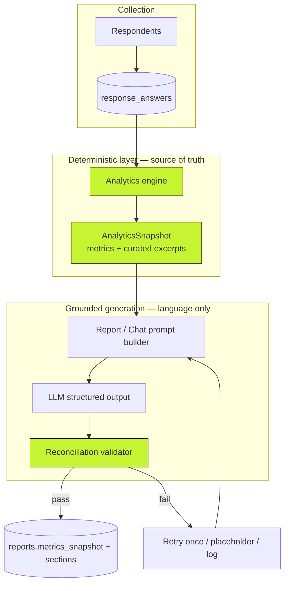
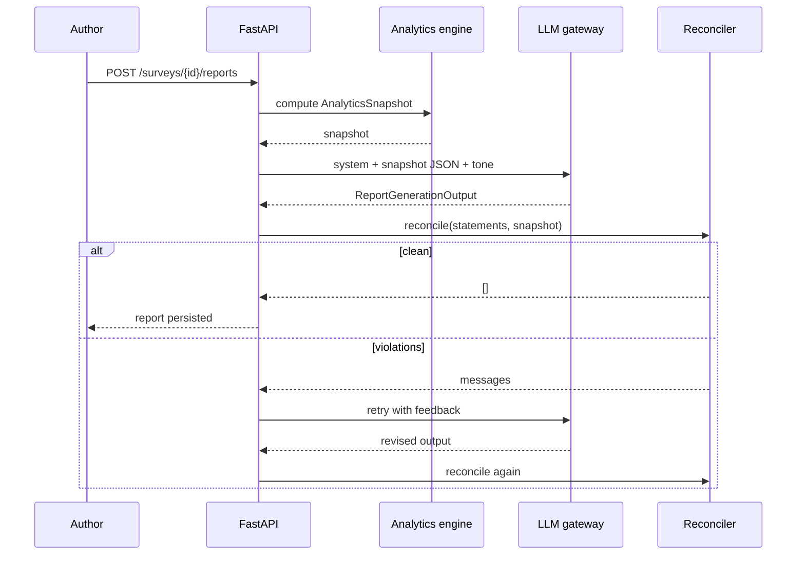
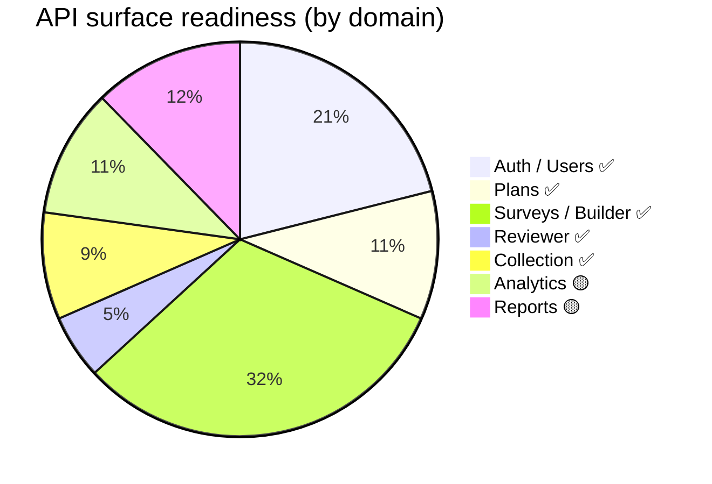

# Survai — Technical Specification Pack

| Field | Value |
| --- | --- |
| **Product** | Survai |
| **Document type** | Engineering specification (model selection, user stories, schemas, AI prompts, analytics, APIs) |
| **Audience** | Product, engineering, AI evaluation, fellowship reviewers |
| **Status legend** | ✅ Live in codebase · 🟡 Spec’d / FE mock · ❌ Not started |
| **API base** | `/api/v1` |
| **Version** | 1.0 · October 2026 |
| **Related** | Root `README.md` (PRD + getting started), `plan.md` (implementation plan) |

---

## Table of contents

1. [Model Selection Criteria](#1-model-selection-criteria)
2. [Module User Stories & Acceptance Criteria](#2-module-user-stories--acceptance-criteria)
3. [Survey JSON Schema Spec](#3-survey-json-schema-spec)
4. [AI Reviewer Prompt Specs](#4-ai-reviewer-prompt-specs)
5. [Heuristic Quality Rules](#5-heuristic-quality-rules)
6. [Analytics Engine Spec](#6-analytics-engine-spec)
7. [Chart Data Architecture](#7-chart-data-architecture)
8. [Grounding / RAG Architecture](#8-grounding--rag-architecture)
9. [AI Report Generator Spec](#9-ai-report-generator-spec)
10. [Backend API Specs](#10-backend-api-specs)
11. [Appendices](#11-appendices)

---

## 1. Model Selection Criteria

Survai separates **language work** (LLM) from **numerical truth** (deterministic code). Model choice therefore optimizes for structured JSON reliability, latency, and cost — never for “doing math.”

### 1.1 Capability matrix by feature

| Feature | Task type | Needs numbers from LLM? | Structured JSON? | Latency budget | Current provider |
| --- | --- | --- | --- | --- | --- |
| Survey Planner | Synthesis / planning | No | Yes (`SurveyPlanOutput`) | Interactive (~5–15s) | Gemini ✅ |
| Survey Builder | Draft generation | No | Yes (`SurveyDraftOutput`) | Interactive | Gemini ✅ |
| Survey Reviewer | Classification + rewrite | No | Yes (`ReviewerOutput`) | Interactive | Gemini ✅ |
| Report Generator | Narrative over metrics | **Forbidden** | Yes (`ReportGenerationOutput`) | Async / progress UI | Spec’d 🟡 |
| Report Chat | Q&A over report + snapshot | **Forbidden** | Yes (`ReportChatOutput`) | Interactive | Spec’d 🟡 |

### 1.2 Selection criteria (weighted)

| Criterion | Weight | Requirement | Rationale |
| --- | --- | --- | --- |
| **Structured output fidelity** | Critical | Native JSON schema / response schema support; Pydantic-validatable | All AI paths reject free text |
| **Instruction following** | Critical | Honors “do not invent numbers / topics” constraints | Trust + anti-hallucination |
| **Latency (p95)** | High | Planner/builder/reviewer usable under ~20s on typical prompts | NFR: no blank waits |
| **Cost per survey lifecycle** | High | Prefer flash/lite for draft tasks; optional stronger model for reports | Pilot budget |
| **Provider abstraction** | High | Swap via `app/ai/client.py` without rewriting prompts | Vendor risk mitigation |
| **Data residency / DPA** | High | Contractual controls for pilot; minimize PII in prompts | PRD §14 |
| **Temperature / determinism** | Medium | Default temp `0.4` for drafts; lower for report if needed | Reproducible-enough drafts |
| **Fallback / rate limits** | Medium | Model fallbacks on 429/503 | Operational resilience |

### 1.3 Recommended model tiers



| Tier | Features | Default (config) | Notes |
| --- | --- | --- | --- |
| **Draft** | Planner, Builder, Reviewer | `gemini-3.1-flash-lite` (see `backend/app/core/config.py`) | Temp `0.4`; JSON MIME + Pydantic schema |
| **Narrative** | Report, Chat | `gemini_model_report` / `gemini_model_chat` reserved | Must receive **only** `AnalyticsSnapshot` + curated excerpts |
| **Never** | Analytics | — | Percentages/counts/cross-tabs are **not** model tasks |

### 1.4 Decision log

| Decision | Choice | Why |
| --- | --- | --- |
| Single AI gateway | `app/ai/client.py` | One place for logging, retries, schema enforcement |
| Gemini for MVP | Google GenAI SDK | Structured JSON + speed for pilot |
| No LLM for analytics | Pandas/SQL engine | Enforces 100% metric reconciliation |
| Prompt versioning | `planner_v1`, `builder_v1`, `reviewer_v1` | Logged per call; safe prompt upgrades |
| No vector RAG for numbers | Metric-grounded generation | Retrieval of prose chunks cannot guarantee numeric integrity |

### 1.5 Evaluation gates before changing models

1. **Schema pass rate** ≥ 98% on a fixed prompt fixture set (no second-retry).
2. **Reviewer issue recall** on a labeled flawed-question set (qualitative, not scientific claim).
3. **Report reconciliation rate** = 100% on known datasets (when report path is live).
4. **PII leakage check** — prompts must not include respondent identifiers unless permitted.
5. **Cost projection** for 10 surveys × 20 reports (north-star volume).

---

## 2. Module User Stories & Acceptance Criteria

Format: **As a** … **I want** … **so that** …  
Acceptance maps to PRD IDs (PLN / BLD / REV / COL / ANL / RPT).

### 2.1 AI Survey Planner ✅

| ID | User story | Acceptance criteria |
| --- | --- | --- |
| **US-PLN-01** | As an M&E officer, I want to describe my research goal in plain language so that I get a structured plan without starting from a blank page. | PLN-01: Free-text accepted; returns objectives, RQs, audiences, sections. |
| **US-PLN-02** | As a researcher, I want editable objectives and research questions so that AI suggestions never lock me in. | PLN-02: Every field editable before builder generation. |
| **US-PLN-03** | As a program officer, I want proposed respondent groups and sections so that the survey structure matches my audience. | PLN-03: Shown as recommendations; not auto-locked. |
| **US-PLN-04** | As an author, I want an estimated length so that I can judge respondent burden early. | PLN-04: Estimate labeled; based on plan content. |
| **US-PLN-05** | As an author, I want to approve a plan so that builder generation is grounded in a committed brief. | PLN-05 + approve endpoint; plan persists and links 1:1 to survey. |

**API:** `POST /plans/generate`, `POST /plans/{id}/generate`, `POST /plans/{id}/approve`, `PATCH /plans/{id}`

---

### 2.2 Survey Builder — AI & Manual ✅

| ID | User story | Acceptance criteria |
| --- | --- | --- |
| **US-BLD-01** | As an author, I want a first-draft questionnaire from an approved plan so that I save design time. | BLD-01: Sections, questions, types, required flags produced. |
| **US-BLD-02** | As an author, I want to regenerate one section so that I don’t lose the rest of the survey. | BLD-02: Only selected section replaced. |
| **US-BLD-03** | As an author, I want to edit any AI text so that nothing is immutable. | BLD-03: Manual edit → `source: ai_edited`. |
| **US-BLD-04** | As an author, I want to create/edit/reorder questions manually so that I can build without AI. | BLD-05–07: CRUD + reorder; preview updates. |
| **US-BLD-05** | As an author, I want core question types so that I can measure program outcomes. | BLD-06: short/long text, single/multi, dropdown, rating, number, date. |

**API:** `POST /surveys/from-plan`, `POST /surveys/{id}/generate`, section/question CRUD + regenerate/reorder

---

### 2.3 AI Survey Reviewer ✅

| ID | User story | Acceptance criteria |
| --- | --- | --- |
| **US-REV-01** | As a researcher, I want leading wording flagged so that I reduce bias before publish. | REV-01: Finding includes question, type, explanation, rewrite. |
| **US-REV-02** | As an M&E officer, I want double-barreled questions flagged so that respondents aren’t forced into one answer for two ideas. | REV-02. |
| **US-REV-03** | As a non-methodologist, I want plain-language explanations so that I understand each flag. | REV-03. |
| **US-REV-04** | As a program lead, I want weak objective coverage called out so that the instrument matches the plan. | REV-04 (should). |
| **US-REV-05** | As an author, I want burden estimates so that I can shorten long surveys. | REV-05: est. minutes + required count. |
| **US-REV-06** | As an author, I want an advisory quality score so that I get a quick summary — without false certification. | REV-06: score + criteria; UI labels “advisory.” |
| **US-REV-07** | As an author, I want to accept or dismiss findings so that the review is human-controlled. | `PATCH /reviewer-findings/{id}` → `open\|accepted\|dismissed`. |

---

### 2.4 Survey Collection ✅

| ID | User story | Acceptance criteria |
| --- | --- | --- |
| **US-COL-01** | As an author, I want a shareable link/QR so that field teams can collect on phones. | COL-01: `/s/{version_id}` on mobile + desktop. |
| **US-COL-02** | As an org, I want responses tied to a frozen version so that history stays meaningful. | COL-02: `structure_snapshot` on publish. |
| **US-COL-03** | As a respondent, I want to answer anonymously without an account. | COL-03. |
| **US-COL-04** | As a respondent, I want progress feedback on long surveys. | COL-04 (should). |
| **US-COL-05** | As an author, I want invalid answers rejected before submit. | COL-05: type/options/min-max validated. |
| **US-COL-06** | As an author, I want to close collection so that no new sessions start. | `POST /surveys/{id}/close`. |

---

### 2.5 Analytics 🟡

| ID | User story | Acceptance criteria |
| --- | --- | --- |
| **US-ANL-01** | As an M&E officer, I want counts and distributions that match stored answers. | ANL-01: Exact reconciliation with DB. |
| **US-ANL-02** | As a researcher, I want percentages with explicit denominators. | ANL-02: Documented denominator per metric. |
| **US-ANL-03** | As an analyst, I want filters/subgroups so that I can slice results. | ANL-03: Recalc on filter DSL. |
| **US-ANL-04** | As a researcher, I want basic cross-tabs. | ANL-04. |
| **US-ANL-05** | As a user, I want charts that match table values. | ANL-05: Single computed source → chart + table. |
| **US-ANL-06** | As an officer, I want exportable analysis. | ANL-06 (should). |

**Status:** Frontend types + mock UI exist; backend engine/APIs are the next build milestone.

---

### 2.6 AI Report Generator + Chat 🟡

| ID | User story | Acceptance criteria |
| --- | --- | --- |
| **US-RPT-01** | As an M&E officer, I want a donor-ready draft report that does not invent numbers. | RPT-01 + reconciliation = 0 ungrounded numerics. |
| **US-RPT-02** | As a manager, I want standard sections (exec summary → conclusion). | RPT-02. |
| **US-RPT-03** | As an author, I want audience/tone modes. | RPT-03 (should): internal / donor / executive. |
| **US-RPT-04** | As a manager, I want to chat with the report for concise briefings. | RPT-04: Answers grounded; disclose insufficient data. |
| **US-RPT-05** | As an author, I want to edit or regenerate sections. | RPT-05. |
| **US-RPT-06** | As an officer, I want PDF/DOCX export. | RPT-06. |

---

### 2.7 Journey map (interactive reference)



---

## 3. Survey JSON Schema Spec

Canonical transport is **snake_case JSON** on the API. The frontend maps to camelCase for UI state.

### 3.1 Question type enum

```
short_text | long_text | single_choice | multiple_choice |
dropdown | rating_scale | number | date
```

| Type | `options` | Typical `validation_rules` | Answer JSON (`answer_value`) |
| --- | --- | --- | --- |
| `short_text` / `long_text` | `null` / `[]` | `{ min_length?, max_length? }` | `string` |
| `single_choice` / `dropdown` | `[{id,label,value}]` | — | `string` (option `value`) |
| `multiple_choice` | same | — | `string[]` |
| `rating_scale` | empty; help_text describes anchors | `{ min: 1, max: 5 }` default | `number` |
| `number` | — | `{ min?, max? }` | `number` |
| `date` | — | — | `string` (ISO date) |

### 3.2 Live survey tree (authoring)

```json
{
  "id": "uuid",
  "plan_id": "uuid|null",
  "organization_id": "uuid|null",
  "created_by": "uuid",
  "title": "string",
  "description": "string|null",
  "status": "draft|published|closed|archived",
  "anonymous_collection": true,
  "current_version_id": "uuid|null",
  "sections": [
    {
      "id": "uuid",
      "survey_id": "uuid",
      "title": "string",
      "description": "string|null",
      "order_index": 0,
      "questions": [
        {
          "id": "uuid",
          "section_id": "uuid",
          "survey_id": "uuid",
          "type": "single_choice",
          "prompt_text": "string",
          "help_text": "string|null",
          "is_required": true,
          "order_index": 0,
          "options": [
            { "id": "opt_a", "label": "Yes", "value": "yes" }
          ],
          "validation_rules": null,
          "conditional_logic": {
            "operator": "AND",
            "rules": [
              { "question_id": "uuid", "op": "eq", "value": "yes" }
            ]
          },
          "source": "ai_generated|manual|ai_edited",
          "ai_generation_meta": {},
          "created_at": "ISO-8601",
          "updated_at": "ISO-8601"
        }
      ]
    }
  ],
  "created_at": "ISO-8601",
  "updated_at": "ISO-8601"
}
```

### 3.3 Published version snapshot (immutable)

Created on `POST /surveys/{id}/publish`. Respondents always see this freeze:

```json
{
  "survey_id": "uuid",
  "title": "string",
  "description": "string|null",
  "anonymous_collection": true,
  "sections": [
    {
      "id": "uuid",
      "title": "string",
      "description": "string|null",
      "order_index": 0,
      "questions": [
        {
          "id": "uuid",
          "type": "rating_scale",
          "prompt_text": "string",
          "help_text": "1 = Poor, 5 = Excellent",
          "is_required": true,
          "order_index": 0,
          "options": null,
          "validation_rules": { "min": 1, "max": 5 },
          "conditional_logic": null
        }
      ]
    }
  ]
}
```

> **Invariant:** Editing the draft survey after publish must **not** mutate historical `structure_snapshot` rows.

### 3.4 Plan schema (planner output → persisted plan)

```json
{
  "research_goal": "string",
  "objectives": ["string"],
  "research_questions": ["string"],
  "target_respondents": ["string"],
  "proposed_sections": [
    { "title": "string", "rationale": "string" }
  ],
  "estimated_length_minutes": 15,
  "status": "draft|approved",
  "ai_generation_meta": {
    "prompt_version": "planner_v1",
    "model": "string",
    "generated_at": "ISO-8601"
  }
}
```

### 3.5 AI draft schemas (Gemini structured output)

**Builder draft question (simplified for model):**

```json
{
  "prompt_text": "What was the main barrier to attendance?",
  "type": "single_choice",
  "options": ["Distance", "Timing", "Cost", "Other"],
  "is_required": true,
  "help_text": ""
}
```

Server converts option labels → `{ id, label, value }` before persistence.

### 3.6 Entity relationship (logical)



---

## 4. AI Reviewer Prompt Specs

| Property | Value |
| --- | --- |
| **Prompt module** | `backend/app/ai/prompts/reviewer_v1.py` |
| **Prompt version** | `reviewer_v1` |
| **Output schema** | `ReviewerOutput` in `backend/app/ai/schemas.py` |
| **Service** | `backend/app/ai/services/reviewer.py` + `backend/app/services/reviewer.py` |
| **Status** | ✅ Live |

### 4.1 System prompt (canonical)

```
You are SurvAI's Survey Reviewer. Given a research plan and a questionnaire
draft, produce a quality review as JSON matching the provided schema.

Rules:
- Findings are advisory only — never claim certification or approval.
- Flag real issues: leading_wording, double_barreled, ambiguous,
  objective_misalignment, or other.
- Every finding needs a clear explanation and a concrete suggested_rewrite
  (or "" if none).
- Use question_id exactly as provided in the questionnaire (UUID strings).
  If a finding is survey-wide, set question_id to "".
- score_criteria: 4–6 criteria with label, score (1.0–5.0), and short description.
- overall_quality_score: weighted sense of overall quality (1.0–5.0), advisory.
- estimated_completion_minutes: realistic completion time for this instrument.
- required_question_count: count of questions marked required in the input.
- Prefer precision over volume — 0–12 findings. Empty findings list is OK if
  the draft is solid.
- notes: one-sentence editor guidance, or "".
```

### 4.2 User prompt assembly

| Block | Contents |
| --- | --- |
| Plan | Research goal, objectives, research questions, target respondents (or “(none linked)”) |
| Questionnaire | Title, required count, then per section: `[uuid] (type, required|optional) prompt` + option labels |

Ends with: `Produce the full reviewer JSON now.`

### 4.3 Output JSON schema

```json
{
  "overall_quality_score": 3.5,
  "estimated_completion_minutes": 12,
  "required_question_count": 8,
  "score_criteria": [
    {
      "label": "Neutrality of wording",
      "score": 3.0,
      "description": "One leading item in section 2"
    }
  ],
  "findings": [
    {
      "question_id": "550e8400-e29b-41d4-a716-446655440000",
      "issue_type": "leading_wording",
      "explanation": "The phrase “Don’t you agree…” pushes agreement.",
      "suggested_rewrite": "How useful was the training for your daily work?"
    }
  ],
  "notes": "Shorten section 3 before publish."
}
```

| Field | Type | Constraints |
| --- | --- | --- |
| `issue_type` | enum | `leading_wording` \| `double_barreled` \| `ambiguous` \| `objective_misalignment` \| `other` |
| Scores | float | Clamped server-side to `[1.0, 5.0]` |
| Findings | 0–12 preferred | Empty allowed |

### 4.4 Post-LLM server guards (required)

| Guard | Behavior |
| --- | --- |
| Empty survey | Reject review request |
| Score clamp | Force `[1.0, 5.0]` |
| Issue whitelist | Unknown types → `other` |
| Question ID resolve | Invalid UUID → survey-wide `null` |
| Required count | Server may recompute as fallback |

### 4.5 Issue type catalogue (product meaning)

| `issue_type` | Definition | Example |
| --- | --- | --- |
| `leading_wording` | Wording pushes a preferred answer | “Don’t you agree the program was successful?” |
| `double_barreled` | One stem asks two distinct things | “Was the training useful and affordable?” |
| `ambiguous` | Unclear referent, jargon, or vague scale | “How often do you engage meaningfully?” |
| `objective_misalignment` | Plan objective weakly covered | Goal is barriers; questions only ask satisfaction |
| `other` | Residual quality issue | Excessive length, missing “prefer not to say,” etc. |

### 4.6 Eval set (minimum)

| Fixture | Expected |
| --- | --- |
| Leading agree-stem | ≥1 `leading_wording` |
| “Useful and timely?” | `double_barreled` |
| Vague frequency without anchors | `ambiguous` |
| Clean short instrument | 0–2 findings ok; no fabricated issues |
| Plan vs questions mismatch | `objective_misalignment` when coverage weak |

---

## 5. Heuristic Quality Rules

Two layers: **deterministic rules** (code) and **model-assisted classification** (reviewer). Deterministic rules are the source of truth for data integrity; the LLM is advisory for language quality.

### 5.1 Layer diagram



### 5.2 Deterministic builder / schema rules

| Rule ID | Rule | Enforcement |
| --- | --- | --- |
| H-BLD-01 | Choice types must have ≥2 options after AI draft | Builder service |
| H-BLD-02 | Allowed types only (enum) | Schema + API validation |
| H-BLD-03 | Rating scale defaults `min=1,max=5` when absent | Server default |
| H-BLD-04 | Manual edit of AI question → `source=ai_edited` | Survey service |
| H-BLD-05 | Section/question reorder must reference owned IDs | API authz + ownership |

### 5.3 Deterministic collection validation

| Rule ID | Rule | When |
| --- | --- | --- |
| H-COL-01 | `single_choice` / `dropdown`: value ∈ option values | Answer upsert |
| H-COL-02 | `multiple_choice`: every element ∈ option values | Answer upsert |
| H-COL-03 | `rating_scale` / `number`: numeric + within min/max | Answer upsert |
| H-COL-04 | Text: string; honor min/max length | Answer upsert |
| H-COL-05 | Required questions enforced on **complete**, not each upsert | Complete |
| H-COL-06 | Closed survey rejects new respondents | Start session |

### 5.4 Deterministic reviewer post-processing

| Rule ID | Rule |
| --- | --- |
| H-REV-01 | Clamp scores to 1–5 |
| H-REV-02 | Whitelist issue types |
| H-REV-03 | Resolve `question_id` against real questions |
| H-REV-04 | Recompute required count if model drifts |

### 5.5 Language heuristics (model-targeted; not hard-coded regex in MVP)

These are **prompt-enforced classifications**, optionally future regex assists:

| Pattern family | Signal examples | Target issue |
| --- | --- | --- |
| Leading stems | “Don’t you agree…”, “Obviously…”, “Wouldn’t you say…” | `leading_wording` |
| Conjunction overload | “and/or” joining two distinct constructs in one stem | `double_barreled` |
| Vague quantifiers | “often”, “regularly”, “adequate” without anchors | `ambiguous` |
| Absolute absolutes | “always / never” forcing extremes | `ambiguous` / `other` |
| Coverage gap | Objectives with zero related questions | `objective_misalignment` |
| Burden | High required count × long text | Burden fields / notes |

### 5.6 Burden heuristic (advisory)

| Input | Estimate approach |
| --- | --- |
| Choice / rating / number / date | ~10–15 seconds each |
| Short text | ~20–30 seconds |
| Long text | ~45–60 seconds |
| Required multiplier | Slight upward bias if many required |

Displayed as **estimate**, never as scientific timing study.

### 5.7 Rules that must never be delegated to the LLM

| Domain | Owner |
| --- | --- |
| Counts, %, means, medians, cross-tabs | Analytics engine |
| Answer type validation | Collection service |
| AuthZ / org isolation | API deps |
| Version snapshot immutability | Collection / publish service |
| Metric reconciliation on reports | `reconciliation.py` (planned) |

---

## 6. Analytics Engine Spec

| Property | Value |
| --- | --- |
| **Target module** | `backend/app/analytics/engine.py` |
| **Status** | 🟡 Spec’d in `plan.md` §10; FE mocks only today |
| **Input grain** | One `survey_version_id` (+ optional filters) |
| **Tech** | Pandas (or Polars) + SQL load |

### 6.1 Design principles

1. **Pure functions** — same rows → same outputs forever.
2. **Zero AI dependency** — engine never imports the LLM client.
3. **Explicit denominators** — every % documents its base.
4. **Version isolation** — never mix answers across versions.
5. **Filter persistence** — every chart/report stores the filter set used.

### 6.2 Function catalogue

| Function | Output | Denominator rule |
| --- | --- | --- |
| `load_frame(version_id, filters)` | DataFrame | Applies AND filter DSL |
| `response_count(df)` | `int` | Started or completed respondents (document which) |
| `valid_count(df, question_id)` | `int` | Non-missing answers for that question |
| `missing_count(df, question_id)` | `int` | Explicit missings — never coerced to 0 |
| `percent_distribution(df, question_id)` | `{label: percent}` | Default: valid responses; return `denominator` field |
| `mean_median(df, question_id)` | `{mean, median, n}` | Numeric/rating only |
| `cross_tab(df, q_a, q_b)` | matrix counts + row/col % | Document row vs column % |
| `completion_rate(df)` | `float` | completed / started |

### 6.3 Filter DSL

```json
{
  "question_id": "uuid",
  "op": "eq|in|gt|lt|between",
  "value": "string|number|string[]"
}
```

- Multiple filters combine with **AND** (OR = post-MVP).
- Cached under key `(survey_version_id, filter_hash)` with short TTL; invalidate on new responses for that version.

### 6.4 AnalyticsSnapshot (handoff to AI reports)

```json
{
  "survey_id": "uuid",
  "survey_version_id": "uuid",
  "generated_at": "ISO-8601",
  "response_count": 128,
  "completion_rate": 0.86,
  "metrics": [
    {
      "key": "q3.percent_distribution.distance",
      "label": "Barrier: Distance",
      "value": 41.2,
      "unit": "percent"
    }
  ],
  "qualitative_excerpts": [
    {
      "question_id": "uuid",
      "respondent_id": "uuid",
      "text": "Transport costs made weekly sessions hard."
    }
  ]
}
```

| Rule | Detail |
| --- | --- |
| Metric keys | Stable, namespaced (`question.stat.bucket`) |
| Qualitative cap | User-curated, hard cap (e.g. 20) |
| Low-n cells | Omit or flag below threshold (e.g. n&lt;5) — do not prompt the LLM with meaningless % |

### 6.5 Engine ↔ API mapping

| Engine call | API |
| --- | --- |
| Summary metrics | `GET /surveys/{id}/analytics/summary` |
| Distributions | `POST /surveys/{id}/analytics/query` |
| Cross-tab | `POST /surveys/{id}/analytics/crosstab` |
| Export | `POST /surveys/{id}/analytics/export` |
| Saved views | `GET/POST /surveys/{id}/saved-analyses` |

### 6.6 Fixture testing contract

```
tests/analytics/fixtures/known_dataset.json
  → hand-computed expected counts/%
  → CI asserts engine outputs match exactly on every PR touching analytics
```

---

## 7. Chart Data Architecture

### 7.1 Single source of truth



**Invariant (ANL-05):** Charts never recompute percentages client-side from raw counts in a divergent way. They bind to engine `percent` fields (or compute once in a shared mapper used by both table and chart).

### 7.2 Frontend type contracts (`features/analytics/api/types.ts`)

| Type | Role |
| --- | --- |
| `DistributionBucket` | `{ label, value, percent }` |
| `QuestionDistribution` | Per-question buckets + `totalResponses` + `missingCount` |
| `CrossTabResult` | Row/col labels + `cells[{rowLabel,colLabel,count,percent}]` |
| `AnalyticsSummary` | Top-line counts + `metrics: MetricValue[]` |
| `Filter` | Same DSL as backend |
| `SavedAnalysis` | Named filter + optional `chartConfig` |

### 7.3 Distribution → Recharts mapping

| Engine / API field | Chart prop |
| --- | --- |
| `bucket.label` | `name` (axis / legend) |
| `bucket.value` | `count` (bar length) |
| `bucket.percent` | tooltip / secondary label |
| `questionId` + selected bucket | drill link to respondents (`?question=&answer=`) |

Supported chart intents:

| Intent | Chart | Data |
| --- | --- | --- |
| Categorical share | Horizontal / vertical bar | `QuestionDistribution.buckets` |
| Rating summary | Bar or bullet of mean + distribution | `mean_median` + buckets |
| Completion | KPI + optional sparkline | `AnalyticsSummary` |
| Cross-tab | HTML matrix (primary); heatmap optional later | `CrossTabResult` |

### 7.4 Chart config object (saved analyses)

```json
{
  "type": "bar",
  "questionId": "uuid",
  "orientation": "horizontal",
  "showPercent": true,
  "filters": []
}
```

Persisted with filters so a saved view is reproducible.

### 7.5 Anti-patterns (forbidden)

| Anti-pattern | Why forbidden |
| --- | --- |
| LLM invents chart series | Breaks numerical integrity |
| Client divides counts with silent missing→0 | Violates data quality rules |
| Mixing versions in one chart | Corrupts meaning |
| Caching across version IDs | Stale / wrong instrument |

---

## 8. Grounding / RAG Architecture

> **Important naming note:** Survai does **not** use classical vector RAG (embeddings + chunk retrieval) for report numbers. “Retrieval” means **retrieving a deterministic `AnalyticsSnapshot`** and binding every numeric claim to a `metric_ref`. This section is the grounding architecture reviewers sometimes label “RAG.”

### 8.1 Why not vector RAG for metrics?

| Approach | Risk for Survai |
| --- | --- |
| Embed response rows / report chunks, retrieve top-k | Model can still invent or mis-state % |
| Ask LLM to “summarize the CSV” | High hallucination risk |
| **Metric-grounded generation + reconciliation** | Numbers must appear in snapshot; violations blocked |

### 8.2 Architecture diagram



### 8.3 Context packages by feature

| Feature | Retrieved / injected context | Explicitly excluded |
| --- | --- | --- |
| Planner | Research goal text | Prior surveys, raw PII |
| Builder | Approved plan row | Raw responses |
| Reviewer | Plan + questionnaire tree | Responses |
| Report | `AnalyticsSnapshot` + tone | Raw `response_answers` |
| Chat | Report sections + **same** `metrics_snapshot` | Fresh unreconciled guesses |

### 8.4 Reconciliation algorithm (planned `app/ai/reconciliation.py`)

```
for each GroundedStatement:
  if metric_ref is null:
    if text contains a digit → VIOLATION (ungrounded numeric)
  else:
    if metric_ref not in snapshot.metrics → VIOLATION
    if stated number ≠ metric.value → VIOLATION
return violations[]  # empty = publishable
```

On violation: retry once with feedback, else replace with flagged placeholder — **never silently show**.

### 8.5 Comparison: Survai grounding vs classical RAG

| Dimension | Classical RAG | Survai grounding |
| --- | --- | --- |
| Index | Vector DB of chunks | Relational metrics snapshot |
| Retrieval key | Embedding similarity | Exact `metric.key` |
| Numeric guarantee | Soft | Hard (validator) |
| Auditability | Chunk citations | Metric keys + snapshot row |
| Failure mode | Hallucinated cite | Block / placeholder |

---

## 9. AI Report Generator Spec

| Property | Value |
| --- | --- |
| **Status** | 🟡 Spec’d (`plan.md` §§8–9, §13); FE mock report today |
| **Service functions** | `generate_report()`, `regenerate_report_section()`, `answer_report_chat()` |
| **Prompt modules (planned)** | `report_v1.py`, `chat_v1.py` |

### 9.1 Pipeline



### 9.2 System prompt hard rules (non-negotiable)

```
You may only state a number that appears in the supplied metrics array,
referenced by its key. Any statement containing a number must set metric_ref
to that key. If the data doesn't support a claim, say so — do not estimate,
extrapolate, or infer.
```

### 9.3 Output schema

```python
class GroundedStatement(BaseModel):
    text: str
    metric_ref: str | None   # must match MetricValue.key, or null for non-numeric

class ReportSection(BaseModel):
    heading: str
    statements: list[GroundedStatement]

class ReportGenerationOutput(BaseModel):
    executive_summary: ReportSection
    methodology: ReportSection
    respondent_profile: ReportSection
    key_findings: ReportSection
    recommendations: ReportSection
    conclusion: ReportSection
```

### 9.4 Tone / audience modes (RPT-03)

| Mode | Voice | Length bias |
| --- | --- | --- |
| `internal` | Direct, operational | Medium |
| `donor` / `professional` | Formal, evidence-forward | Full sections |
| `executive` | Brief, decision-oriented | Short |

### 9.5 Report chat

| Input | Output |
| --- | --- |
| User question + report `sections` + frozen `metrics_snapshot` | `ReportChatOutput{ answer, metric_refs[], confidence }` |

`confidence`: `grounded` | `partial` | `insufficient_data`

Same reconciliation rules apply to numeric claims in chat answers.

### 9.6 Persistence

| Column / field | Purpose |
| --- | --- |
| `reports.sections` | Generated structure |
| `reports.metrics_snapshot` | Exact snapshot used — immutable for that report version |
| Chat `metric_refs` | Keys into that snapshot |

Regenerating a section **recomputes a fresh snapshot** for consistency rather than silently mixing old metrics with new narrative.

### 9.7 Export

| Format | Path |
| --- | --- |
| PDF / DOCX | `POST /reports/{id}/export` → `202` + job → `GET /exports/{id}` |

Long generations must surface progress (NFR).

---

## 10. Backend API Specs

**Base URL:** `{HOST}/api/v1`  
**Auth:** JWT access cookie (`access_token`) or `Authorization: Bearer`; refresh via httpOnly cookie.  
**Content-Type:** `application/json`

### 10.1 Status overview



---

### 10.2 Health

| Method | Path | Auth | Description |
| --- | --- | --- | --- |
| GET | `/health` | Public | Liveness |

---

### 10.3 Auth ✅

| Method | Path | Auth | Body / notes |
| --- | --- | --- | --- |
| POST | `/auth/register` | Public | Creates org + user; may return `dev_code` in dev |
| POST | `/auth/verify-email` | Public | OTP → sets cookies |
| POST | `/auth/resend-verification` | Public | |
| POST | `/auth/login` | Public | Blocked until verified |
| POST | `/auth/refresh` | Cookie/body | Rotates tokens |
| POST | `/auth/logout` | Auth | Clears cookies |
| GET | `/auth/me` | Auth | Current user |
| POST | `/auth/forgot-password` | Public | |
| POST | `/auth/reset-password` | Public | Token + new password |

**Roles:** `system_admin` | `organization`

---

### 10.4 Users ✅

| Method | Path | Auth |
| --- | --- | --- |
| GET/PATCH | `/users/me` | Current user |
| POST | `/users/me/password` | Current user |
| DELETE | `/users/me` | Current user |
| GET/POST | `/users` | Admin |
| GET/PATCH | `/users/{user_id}` | Admin |

---

### 10.5 Plans ✅

| Method | Path | Description |
| --- | --- | --- |
| GET | `/plans` | List org plans |
| POST | `/plans` | Create empty/manual plan |
| POST | `/plans/generate` | Create + AI generate |
| GET | `/plans/{plan_id}` | Detail |
| PATCH | `/plans/{plan_id}` | Edit fields |
| POST | `/plans/{plan_id}/generate` | Regenerate AI fields (hard replace) |
| POST | `/plans/{plan_id}/approve` | Mark approved for builder |

---

### 10.6 Surveys & builder ✅

| Method | Path | Description |
| --- | --- | --- |
| GET | `/surveys` | List |
| POST | `/surveys` | Create |
| POST | `/surveys/from-plan` | Get-or-create 1:1; optional AI generate |
| GET | `/surveys/{survey_id}` | Full tree |
| PATCH | `/surveys/{survey_id}` | Metadata / flags |
| DELETE | `/surveys/{survey_id}` | Delete |
| POST | `/surveys/{survey_id}/generate` | AI full draft |
| POST | `/surveys/{survey_id}/publish` | Freeze version; returns collection path `/s/{version_id}` |
| POST | `/surveys/{survey_id}/close` | Stop new respondents |
| GET | `/surveys/{survey_id}/collect-stats` | Live collection stats |
| POST | `/surveys/{survey_id}/sections` | Add section |
| PATCH/DELETE | `/surveys/{survey_id}/sections/{section_id}` | |
| POST | `/surveys/{survey_id}/sections/{section_id}/regenerate` | AI one section |
| POST | `/surveys/{survey_id}/sections/reorder` | `{ section_ids: [] }` |
| POST | `/surveys/{survey_id}/questions` | Add question |
| PATCH/DELETE | `/surveys/{survey_id}/questions/{question_id}` | |
| POST | `/surveys/{survey_id}/questions/reorder` | |

---

### 10.7 Reviewer ✅

| Method | Path | Description |
| --- | --- | --- |
| POST | `/surveys/{survey_id}/review` | Run AI review |
| GET | `/surveys/{survey_id}/review/latest` | Latest run + findings |
| PATCH | `/reviewer-findings/{finding_id}` | `{ status: open\|accepted\|dismissed }` |

---

### 10.8 Public collection ✅ (unauthenticated)

| Method | Path | Description |
| --- | --- | --- |
| GET | `/public/surveys/{version_id}` | Frozen instrument |
| POST | `/public/surveys/{version_id}/respondents` | Start session → `session_token` |
| POST | `/public/respondents/{respondent_id}/answers` | Upsert answer (+ session token) |
| POST | `/public/respondents/{respondent_id}/complete` | Validate required; complete |

**Answer payload sketch:**

```json
{
  "session_token": "string",
  "question_id": "uuid",
  "answer_value": "yes"
}
```

`answer_value`: `string | number | string[] | null`

---

### 10.9 Analytics 🟡 (planned)

| Method | Path | Description |
| --- | --- | --- |
| GET | `/surveys/{id}/analytics/summary` | Top-line + metrics |
| POST | `/surveys/{id}/analytics/query` | Distributions for question IDs + filters |
| POST | `/surveys/{id}/analytics/crosstab` | `{ question_a_id, question_b_id, filters? }` |
| POST | `/surveys/{id}/analytics/export` | Export job |
| GET/POST | `/surveys/{id}/saved-analyses` | Named filter views |

**Example query body:**

```json
{
  "question_ids": ["uuid-1", "uuid-2"],
  "filters": [
    { "question_id": "uuid-gender", "op": "eq", "value": "female" }
  ]
}
```

**Example summary response:**

```json
{
  "survey_id": "uuid",
  "survey_version_id": "uuid",
  "response_count": 128,
  "completion_rate": 0.86,
  "avg_completion_minutes": 11.4,
  "metrics": [
    {
      "key": "completion_rate",
      "label": "Completion rate",
      "value": 86.0,
      "unit": "percent"
    }
  ]
}
```

---

### 10.10 Reports 🟡 (planned)

| Method | Path | Description |
| --- | --- | --- |
| POST | `/surveys/{id}/reports` | Generate (may `202` + job) |
| GET | `/reports/{id}` | Fetch |
| PATCH | `/reports/{id}` | Edit text |
| POST | `/reports/{id}/sections/{key}/regenerate` | One section |
| POST | `/reports/{id}/export` | PDF/DOCX job |
| GET | `/exports/{id}` | Download / status |
| POST | `/reports/{id}/chat` | Grounded Q&A |
| GET | `/reports/{id}/chat/history` | Thread |

**Chat request:**

```json
{
  "message": "What should we tell the donor in two sentences?",
  "tone": "executive"
}
```

**Chat response:**

```json
{
  "answer": "Among 128 respondents, distance was the top barrier (41%). …",
  "metric_refs": ["q3.percent_distribution.distance", "summary.response_count"],
  "confidence": "grounded"
}
```

---

### 10.11 Error model (conventional)

| HTTP | Meaning |
| --- | --- |
| 400 | Validation / business rule (e.g. empty survey review) |
| 401 | Unauthenticated |
| 403 | Wrong org / role |
| 404 | Missing resource |
| 409 | Conflict (e.g. publish state) |
| 422 | Pydantic validation |
| 429 | Upstream AI rate limit (after fallbacks) |
| 502/503 | AI provider failure |

Error body (typical FastAPI):

```json
{ "detail": "Human-readable message" }
```

---

### 10.12 AuthZ matrix (MVP)

| Resource | `organization` member | `system_admin` | Public |
| --- | --- | --- | --- |
| Own org plans/surveys | CRUD (scoped) | Yes | No |
| Other org data | No | Platform ops only | No |
| `/public/*` collection | — | — | Yes |
| `/users` admin list | No | Yes | No |

---

## 11. Appendices

### A. Implementation status snapshot

| Area | Status |
| --- | --- |
| Auth + org accounts | ✅ |
| Planner AI | ✅ |
| Builder AI + manual | ✅ |
| Reviewer AI | ✅ |
| Publish + public collect | ✅ |
| Analytics engine + APIs | 🟡 FE mock |
| Report generator + chat + reconciliation | 🟡 Spec / FE mock |
| Vector RAG | ❌ Intentionally out (use metric grounding) |

### B. Source-of-truth file map

| Spec topic | Primary paths |
| --- | --- |
| Survey schemas | `backend/app/schemas/survey.py`, `models/survey.py` |
| Collection / snapshot | `backend/app/models/collection.py`, `services/collection.py` |
| AI schemas | `backend/app/ai/schemas.py` |
| Reviewer prompts | `backend/app/ai/prompts/reviewer_v1.py` |
| Planner / builder prompts | `backend/app/ai/prompts/planner_v1.py`, `builder_v1.py` |
| Analytics FE types | `frontend/src/features/analytics/api/types.ts` |
| Master plan | `plan.md` §§8–11 |
| Product PRD + runbook | `README.md` |

### C. Glossary (engineering)

| Term | Meaning |
| --- | --- |
| **AnalyticsSnapshot** | Frozen computed metrics (+ optional excerpts) passed to report/chat |
| **metric_ref** | Key into `AnalyticsSnapshot.metrics` |
| **Reconciliation** | Validator that blocks ungrounded numeric claims |
| **structure_snapshot** | Immutable published questionnaire JSON |
| **Heuristic rule** | Deterministic validation/quality rule in code |
| **Prompt version** | Logged identifier (`reviewer_v1`, …) for auditability |

### D. Document control

| Version | Date | Notes |
| --- | --- | --- |
| 1.0 | Oct 2026 | Initial consolidated pack aligned to live backend + planned analytics/reports |

---

*End of Survai Technical Specification Pack*
